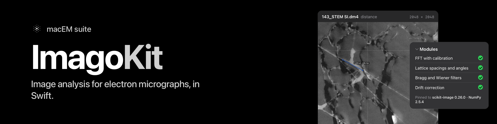

<p align="center"></p>

# ImagoKit

Image analysis for electron micrographs, in Swift, for macOS and iPadOS: the Fourier transform of an image with its
calibration, lattice spacings and angles measured from FFT spots, Bragg (masked inverse FFT) filtering, the HRTEM
background-subtraction and Wiener filters, and drift correction and stack alignment. Each number is defined once,
pinned against the Python packages the field already uses, and checked against planted lattices whose answer is known.

**Status: pre-release (0.x).** Four modules are available: `ImagoCore`, `ImagoFFT` (spectrum, radial profile, spot
spacings and angles, the masked inverse FFT) and `ImagoFilters` (the HRTEM filters), each on a Float32 and a Float64 path,
and `ImagoAlignment`, which registers an image onto another by phase correlation refined to a fraction of a pixel, shifts
images (SciPy's orders 0 and 1 and the Fourier shift), estimates the drift of a stack and sums it aligned. The supported
functions, set against the reference packages' documented API, are listed in [`docs/parity.md`](docs/parity.md). The
definitions and validation notes behind each number are in [`docs/`](docs/).

**Platform.** Apple platforms only today (macOS 15 and iOS 18 or newer): the FFT engine uses Accelerate's vDSP, and the
package is built and tested on macOS only. Linux is not supported yet.

## What it computes

| Module | Scope | Reference | Since |
|---|---|---|---|
| `ImagoCore` | the calibrated image (pixels, per-axis scale, unit and origin, crops); length units; the exact N-point 2D DFT for every image size, Float32 on Accelerate's vDSP and a Float64 reference path | `numpy.fft.fft2` / `ifft2` | 0.0.1 |
| `ImagoFFT` | the centred magnitude and power spectrum with `fftshift(fftfreq(n, d))` axes per axis; the radial profile against physical \|q\|; a spot's position (snap, sub-pixel centroid of a Hann-windowed spectrum), its spacing d = 1/\|q\| and the angle between two spots; the masked inverse FFT with raised-cosine spots and Friedel partners | NumPy, and planted lattices | 0.0.1 |
| `ImagoFilters` | the HRTEM average background subtraction filter (ABSF) and Wiener filter (Kilaas 1998, as D. R. G. Mitchell's DigitalMicrograph script describes them) | a float64 NumPy/SciPy reading of the same steps (`scipy.ndimage.median_filter`, `map_coordinates`) | 0.0.2 |
| `ImagoAlignment` | phase cross-correlation with sub-pixel refinement, sub-pixel shifts, drift series and aligned stack sums | `skimage.registration.phase_cross_correlation`, `scipy.ndimage.shift`, `fourier_shift` | 0.1.0 |

Since 0.7.0: `ImagoFilters.Thresholding` (Otsu, Li, Yen, triangle, mean, ISODATA, local, hysteresis), `ImagoCore.BinaryMorphology`, `ObjectStatistics` (labelled sums, extrema, centre of mass, areal density and `N_V`), `Segmentation.regionProperties` (perimeter, Feret, solidity, Euler number, intensity), `WindowFunction.apply`, `PeakLocalMax` spectrum symmetry.

Since 0.6.0: `ImagoCore.FFTSurface` (`fft2`/`ifft2` with `axes` and `norm`, `rfft2`/`irfft2`, `fftshift`/`ifftshift`),
`ImagoFilters` `SeparableFilters` (`gaussian_filter`, `uniform_filter`), `BandpassFilters` (`butterworth`,
`difference_of_gaussians`), `WindowFunction`, `PeakLocalMax`, spline-order `ImageShift` and masked `PhaseCorrelation`.
`docs/parity.md` lists every function of the references and where it stands; `docs/benchmarks.md` has the timings.

Planned, not yet available: GPA strain (Hÿtch, Snoeck and Kilaas 1998), atom-column finding (Atomap, GPL-3.0,
in a module of its own), denoising (scikit-image `restoration`), `ndimage.zoom` and `rotate`.

## Complex 1D FFT

`ImagoFFT` also provides `FFT1D` (Float) and `FFT1DDouble` (Double). Both accept a positive power-of-two
length, transform caller-owned split-complex arrays in place, and are Sendable. A plan may be shared across
concurrent calls with separate buffers.

```swift
import ImagoFFT

var real = [Float](repeating: 0, count: 64)
var imaginary = real
real[0] = 1
let fft = FFT1D(n: real.count)!
fft.transform(re: &real, im: &imaginary, forward: true)
fft.transform(re: &real, im: &imaginary, forward: false)
// Both directions are unnormalised: divide these inverse results by Float(fft.n).
```

`FFT1D.nextPow2(_:)` returns the smallest power of two at least its argument (one for arguments ≤ 1);
values above the largest positive power of two representable by `Int` violate its precondition.
Length one is the identity. Initialisation returns `nil` for unsupported lengths or allocation failure;
transform buffers must each have exactly `n` elements. No windowing, padding or centring is implicit.
NumPy 2.5.4 pins cover lengths 1, 2, 4, 8, 64, 256 and 1024. The tests state the complex-bin tolerances:
1e-5 for Float and 1e-12 for Double, with an absolute floor for near-zero bins.

## Conventions (the short version)

- Pixels are row-major, x (column) fastest, row 0 first. A pixel's physical position is `(index − origin) · scale`.
- The zero frequency of a centred spectrum sits at index `n/2` (integer division) on each axis, odd and even `n` alike, as
  `numpy.fft.fftshift` puts it. The axis value at index `i` is `(i − n/2) / (n · d)`, `d` that axis's own scale, so a
  non-square or anisotropic image has different spacings along x and y.
- The 2D forward transform is unnormalised and its inverse divides by `nx · ny`, as NumPy's. Nothing is windowed, padded or
  mean-removed unless a function says so on its signature.
- Every Float32 result states its registered distance from NumPy's float64 result; speed never changes a number silently.

## Install

```text
// Package.swift
dependencies: [
    .package(url: "https://github.com/mac4DSTEM/ImagoKit.git", exact: "0.7.0"),
],
targets: [
    .target(name: "MyApp", dependencies: [
        .product(name: "ImagoFFT", package: "ImagoKit"),
    ]),
]
```

Swift 6.2 tools or newer; macOS 15 or iOS 18. Foundation and Accelerate only; no other dependency. Build your app in Release
or with `-O` for the kit: the manifest carries no optimisation flags (a versioned dependency cannot).

## The first ten minutes

A lattice image with two spots: its spectrum, its radial profile, both spacings and the angle between them, a Bragg filter
on one spot, the HRTEM filters, and the registration of a drifted copy. This program is compiled and run as it stands by `tools/readme-consumer` (every line
below is checked against that consumer's source in CI).

```swift
import Foundation
import ImagoAlignment
import ImagoCore
import ImagoFFT
import ImagoFilters

// A 256 × 256 image, 0.02 nm pixels: two lattice fringes on a constant background.
let n = 256
var pixels = [Float](repeating: 0, count: n * n)
for row in 0..<n {
    for col in 0..<n {
        let x = Double(col) / Double(n), y = Double(row) / Double(n)
        pixels[row * n + col] = Float(100 + 10 * cos(2 * Double.pi * (40 * x + 12 * y)) + 6 * cos(2 * Double.pi * (-15 * x + 35 * y)))
    }
}
let image = try Micrograph(width: n, height: n, pixels: pixels,
                           x: AxisCalibration(scale: 0.02, unit: "nm"), y: AxisCalibration(scale: 0.02, unit: "nm"))

// The centred spectrum (NumPy's fftshift(fft2(x))) and its radial profile against physical |q|.
let spectrum = try PowerSpectrum.compute(image)
let profile = try RadialProfile.compute(spectrum)
print("spectrum", spectrum.width, "×", spectrum.height, "in", spectrum.unitsX, "; profile bins:", profile.points.count)

// Click near each spot (row, column of the centred spectrum): the estimator snaps and refines to sub-pixel.
let a = try SpotMeasurement.measure(image, clickRow: n / 2 + 12, clickColumn: n / 2 + 40)
let b = try SpotMeasurement.measure(image, clickRow: n / 2 + 35, clickColumn: n / 2 - 15)
let pair = try LatticePair.measure(a, b)
print(String(format: "d₁ = %.4f nm, d₂ = %.4f nm, angle = %.2f°", a.dNanometres!, b.dNanometres!, pair.angle))

// Keep only the first lattice (a Bragg filter), then the HRTEM background-subtraction and Wiener filters.
let bragg = try MaskedInverseFFT.compute(image, spots: [a.maskSpot(radius: 3, edge: 2)])
let filtered = try HRTEMFilter.filter(image)
print("Bragg-filtered image:", bragg.image.count, "pixels; HRTEM filters ran", filtered.passes, "passes")

// Drift: a field of three blobs, displaced by a known sub-pixel amount, is registered back (phase correlation refined to
// 1/20 pixel) and the pair is summed after alignment.
var blobs = [Float](repeating: 5, count: n * n)
for (r0, c0) in [(60.0, 70.0), (120.0, 180.0), (190.0, 90.0)] {
    for row in 0..<n {
        for col in 0..<n {
            let d2 = (Double(row) - r0) * (Double(row) - r0) + (Double(col) - c0) * (Double(col) - c0)
            blobs[row * n + col] += Float(100 * exp(-d2 / 18))
        }
    }
}
let field = try Micrograph(width: n, height: n, pixels: blobs)
let drifted = try ImageShift.fourierShift(field, by: PixelShift(row: -2.5, column: 1.25))
let drift = try PhaseCorrelation.register(reference: field, moving: drifted, upsampleFactor: 20, normalization: .unnormalized)
let summed = try AlignedSum.sum([field, drifted], shifts: [.zero, drift.shift])
print("registered drift:", drift.shift.row, drift.shift.column, "px; aligned sum of", summed.frameCount, "frames")
```

## Checking it yourself

```bash
swift test -c release              # the test suite
tools/consumer-check/run.sh        # a separate package that uses only the public API
tools/readme-consumer/run.sh       # this README's program, compiled and run
```

The fixtures the tests read are generated by `tools/slice-*/pins.py` against the pinned NumPy, SciPy and scikit-image
(`tools/oracle/references-lock.txt`; a pinned-environment setup script builds it). Numbers are held to the Python
reference within its own tolerance; `docs/parity.md` lists each function, its state and its tolerance. See
[`CONTRIBUTING.md`](CONTRIBUTING.md) before changing a number.

## Known limits

- iOS 18 builds but has never been run on a device or simulator; macOS 15 is declared but built and tested on macOS 27 only.
- A first call of a vDSP 1D FFT or DFT size can differ by one Float32 ulp.
- Float32 tolerances are claims on the planted and pinned cases, not proofs for every input.
- Spline-order shifts refuse the `constant` and `wrap` modes; the masked registration returns the shift only, and a symmetric pair with exactly tied maxima is not reproducible (`docs/open-items.md`).
- No number is validated on a microscope; the HRTEM filters have never been compared with DigitalMicrograph.
- Not yet checked on a raw (counts) HRTEM image; the available TIFFs are 8-bit renders.

## Please cite

If ImagoKit contributes to published work, please cite it using [`CITATION.cff`](CITATION.cff) (GitHub's "Cite this
repository" button reads it), and cite the reference packages whose definitions it follows: NumPy, SciPy and
scikit-image.

## Licence

GPL-3.0 ([`LICENSE`](LICENSE)). Copyright (c) 2026 Paul Lobpreis.
[`NOTICE`](NOTICE) records the provenance and reference packages.

## Not claimed

No result is validated on a microscope. The HRTEM filters have never been compared with DigitalMicrograph. Agreement with
NumPy is agreement; the planted lattices and closed forms are the truth the tests hold.
